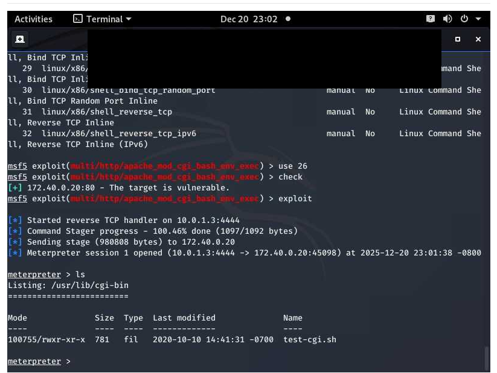
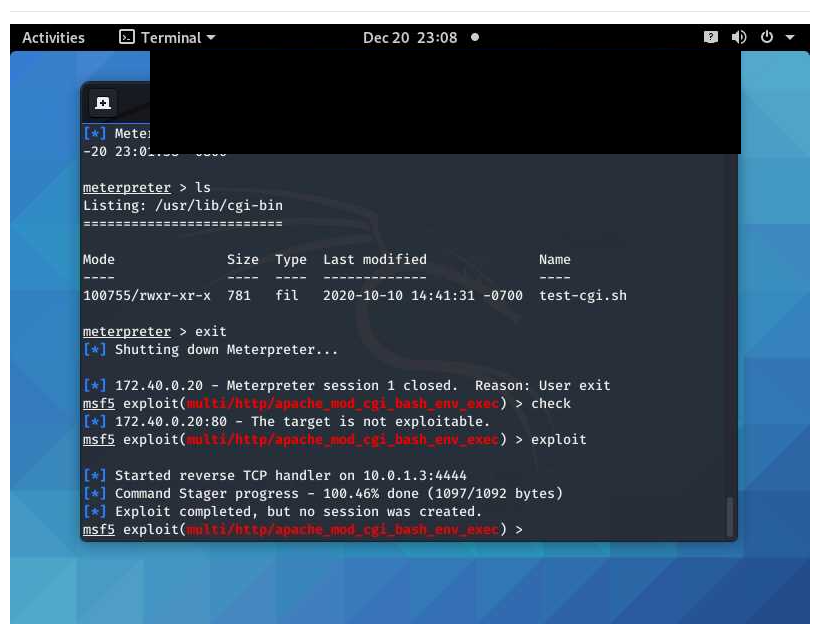

# Network Defense and Vulnerability Remediation Lab

**Original exercise:** Defending the Network from a Simulated Attack (3e), Network Security, Firewalls, and VPNs — Lab 02  
**Environment:** Guided educational lab using simulated systems.

## Overview

This project documents an attack-and-defense exercise: reviewing simulated network compromise, verifying a Shellshock vulnerability, installing a Bash package update, and repeating the exploit test to evaluate remediation. Supporting evidence also covers Linux antivirus testing, a Windows Security scan, and pfSense DMZ firewall changes.

## Tools and skills

- Infection Monkey: propagation map, security recommendations, and ATT&CK report review
- Metasploit: controlled vulnerability validation and post-remediation retesting
- Linux / Bash: version inspection and package installation with dpkg
- ClamAV: detection and relocation of EICAR antivirus test files
- Windows Security: custom scan review
- pfSense: DMZ firewall rule review and applied changes
- Technical documentation: evidence, results, and limitations

## Evidence-supported results

| Activity | Observed result |
| --- | --- |
| Attack simulation | Infection Monkey reported seven discovered machines and four successfully breached machines (57%). |
| Initial Shellshock test | A Meterpreter session opened on the lab target. |
| Bash remediation | The screenshot shows installation of the supplied Bash 5.0 package. |
| Shellshock retest | The module reported the target was not exploitable; the repeated exploit created no session. |
| Linux antivirus test | ClamAV detected two EICAR test files and moved them to a VIRUS directory. |
| Windows antivirus scan | A custom scan of eight files reported zero threats. |
| Firewall changes | pfSense reported successfully applied DMZ changes; the rule table showed no pass rules. |

## Before and after

### Before remediation

### After remediation

The retest supports remediation of the tested exploit path in this lab. It does not establish that every vulnerability was removed.

## Documentation

- [Lab report](lab-report.md)
- [Screenshot evidence index](evidence-index.md)

## Scope and limitations

This was a guided academic exercise, not a production engagement or independently designed penetration test. EICAR files are antivirus test artifacts. The Windows scan covers only the eight scanned files. The firewall screenshot does not include a subsequent connectivity test. Screenshot watermarks containing personal attribution and lab-session details have been redacted.
